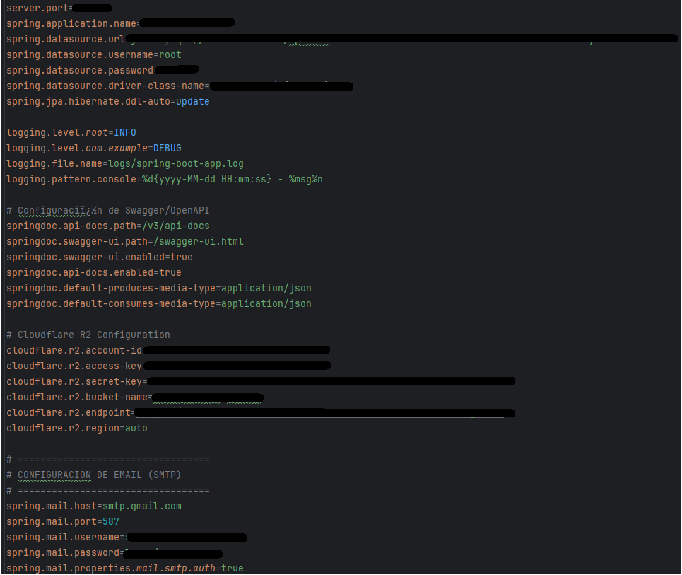

# 🛡️ Informe de Auditoría de Seguridad - POO20205-GRPO10

**Proyecto Auditado:** `poo20205-grpo10` (`POO2025-GRUPO10` - API REST Spring Boot)  
**Fecha:** 14 de Septiembre, 2026  
**Auditor:** AppSec Student / DevSecOps Junior  
**Estado:** En Proceso  

---

## 📌 Resumen Ejecutivo de Hallazgos

| ID | Vulnerabilidad | Severidad | Categoría OWASP | Estado |
|---|---|---|---|---|
| **VULN-001** | Exposición de Secretos y Credenciales en Texto Plano en Código Fuente Versionado | **ALTA** | API8:2023 – Security Misconfiguration / Hardcoded Credentials | Confirmada / Documentada |

---

## 🚨 Vulnerabilidad VULN-001: Hardcoded Credentials en `application.properties`

### 1. Descripción Breve
El archivo de configuración principal de la aplicación (`src/main/resources/application.properties`) almacena credenciales de producción e infraestructura en texto plano, incluyendo la contraseña de aplicación de Gmail (SMTP) y las claves secretas de acceso al almacenamiento en la nube de Cloudflare R2. Al estar commiteado en el repositorio de control de versiones Git, cualquier usuario o atacante con acceso al código o a su historial puede tomar control de estos servicios externos.

### 2. Clasificación OWASP y Severidad
- **Categoría OWASP API Top 10:** API8:2023 – Security Misconfiguration
- **Categoría OWASP Web Top 10:** A05:2021 – Security Misconfiguration / A02:2021 – Cryptographic Failures
- **CVSS v3.1 Vector:** `CVSS:3.1/AV:N/AC:L/PR:N/UI:N/S:U/C:H/I:N/A:N` (**Score: 7.5 - ALTA**)

---

### 3. Evidencia de Auditoría (POC)

1. Se inspecciona la estructura de configuración del proyecto en el archivo `POO2025-GRUPO10/src/main/resources/application.properties`.
2. Se confirma la existencia de tokens de API y contraseñas escritas directamente en texto plano:



---

### 4. Análisis de Código Vulnerable

Fragmento defectuoso en `src/main/resources/application.properties`:

```properties
# Cloudflare R2 Configuration (SECRETOS EXPUESTOS EN GIT)
cloudflare.r2.account-id=0e4cc880d4baf4d290c1ff09ac37fb69
cloudflare.r2.access-key=aef94d7352f1762456eb097a368ad19d
cloudflare.r2.secret-key=bb21337fd3b6f31c73893bd588a91593460045f4a92fb9b1620e2a7c3d4d6237

# CONFIGURACION DE EMAIL (SMTP) (PASSWORD EXPUESTAS EN GIT)
spring.mail.username=rolapalermo@gmail.com
spring.mail.password=lreywjcweoeqzyvn
```

---

### 5. Remediación Recomendada (Código Seguro)

#### A. Refactorización en `application.properties`:
Reemplazar los valores en texto plano por inyección dinámica de Variables de Entorno con la sintaxis de Spring `${NOMBRE_VARIABLE}`:

```properties
# Cloudflare R2 Configuration
cloudflare.r2.account-id=${CLOUDFLARE_R2_ACCOUNT_ID}
cloudflare.r2.access-key=${CLOUDFLARE_R2_ACCESS_KEY}
cloudflare.r2.secret-key=${CLOUDFLARE_R2_SECRET_KEY}
cloudflare.r2.bucket-name=${CLOUDFLARE_R2_BUCKET:comprobantes-envios}
cloudflare.r2.endpoint=${CLOUDFLARE_R2_ENDPOINT}
cloudflare.r2.region=auto

# CONFIGURACION DE EMAIL (SMTP)
spring.mail.host=smtp.gmail.com
spring.mail.port=587
spring.mail.username=${SMTP_USERNAME}
spring.mail.password=${SMTP_PASSWORD}
spring.mail.properties.mail.smtp.auth=true
spring.mail.properties.mail.smtp.starttls.enable=true
```

#### B. Protocolo de Mitigación DevSecOps:
1. **Rotación de Secretos:** Revocar inmediatamente el token de Cloudflare R2 y eliminar la Contraseña de Aplicación en la cuenta de Google.
2. **Higiene de Git:** Purgar del historial de commits los valores antiguos mediante herramientas como `git filter-repo` o `BFG Repo-Cleaner`.

