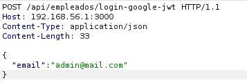
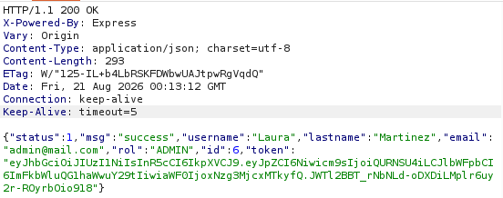
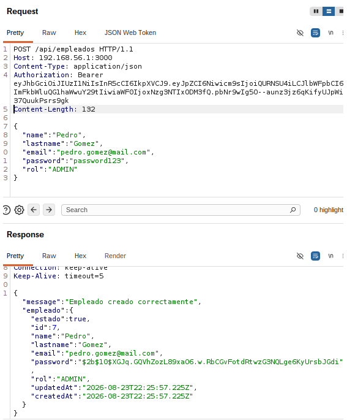
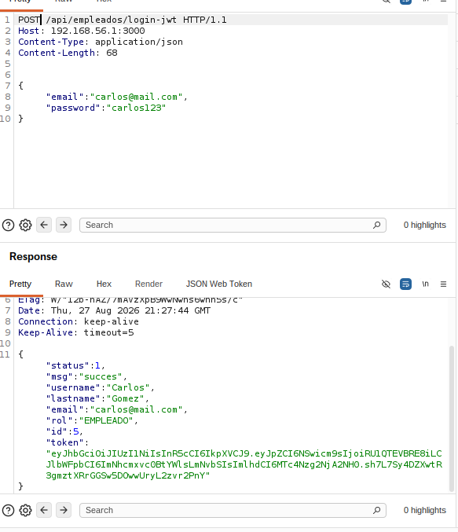
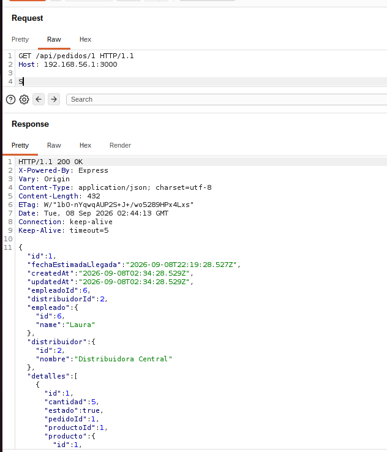

# 🛡️ Informe de Auditoría de Seguridad de Aplicaciones (AppSec Assessment Report)

**Proyecto Auditado:** `proyectoweb` (Sistema de Gestión de Inventarios y Pedidos)  
**Componentes Evaluados:** Backend REST API (`proybackendgrupo05`) & Frontend SPA (`proyfrontendgrupo05`)  
**Tipo de Evaluación:** Auditoría de Caja Blanca / White-Box (Revisión Estática de Código Fuente + DAST Asistido)  
**Acceso al Código Fuente:** Sí (Acceso irrestricto a repositorios Git, esquemas de base de datos, rutas, controladores y configuraciones)  
**Período de Ejecución:** 21 de Agosto de 2026 – 8 de Septiembre de 2026  
**Fecha de Consolidación:** 3 de Noviembre de 2026  
**Auditor Responsable:** Auditor AppSec / DevSecOps Junior  
**Audiencia Objetivo:** Desarrolladores Backend & Frontend, Líderes Técnicos, Arquitectos de Software y Equipos de Operaciones  

---

## 📌 1. Resumen Ejecutivo de Hallazgos

Durante el período comprendido entre el 21 de agosto y el 8 de septiembre de 2026, se ejecutó una auditoría integral de seguridad sobre la arquitectura del proyecto `proyectoweb`. La evaluación combinó el análisis estático de código fuente (Code Review manual) con pruebas dinámicas de penetración (DAST) sobre los servicios en ejecución.

Se identificaron **5 vulnerabilidades principales**, categorizadas según el estándar internacional **OWASP API Security Top 10 (2023)** y **OWASP Top 10 (2021)**:

| ID | Vulnerabilidad | Severidad (CVSS v3.1) | Categoría OWASP | Estado | Fecha Descubrimiento |
|:---|:---|:---|:---|:---|:---|
| **VULN-001** | Bypass Crítico de Autenticación en Login Google OAuth por Ausencia de Validación de ID Token | **CRÍTICA (9.8)** | API2:2023 – Broken Authentication / A07:2021 | Confirmada / Documentada | 21/08/2026 |
| **VULN-002** | Fuga de Información Sensible por Exposición de Hashes Bcrypt de Contraseñas en Respuestas API | **ALTA (6.5)** | API3:2023 – Broken Object Property / A01:2021 | Confirmada / Documentada | 23/08/2026 |
| **VULN-003** | Escalación Vertical de Privilegios por Control de Acceso Roto a Nivel de Función (BFLA) | **ALTA (6.5)** | API5:2023 – Broken Function Level Authorization | Confirmada / Documentada | 27/08/2026 |
| **VULN-004** | Exposición de Claves de API y Secretos en Texto Plano en Código Fuente Versionado | **MEDIA (5.3)** | API8:2023 – Security Misconfiguration / CWE-798 | Confirmada / Documentada | 04/09/2026 |
| **VULN-005** | Acceso No Autorizado a Objetos de Negocio (BOLA / IDOR) en la Consulta de Pedidos | **ALTA (7.5)** | API1:2023 – Broken Object Level Authorization | Confirmada / Documentada | 08/09/2026 |

---

## 🧭 2. Metodología de Auditoría Utilizada

La auditoría se rigió bajo los lineamientos metodológicos de:
* **OWASP Web Security Testing Guide (WSTG v4.2)**: Marco estandarizado para pruebas de seguridad web.
* **OWASP API Security Top 10 (2023)**: Clasificación de riesgos críticos específicos para interfaces de programación de aplicaciones (APIs REST).

### Fases de la Metodología Aplicada:

```
[ 1. Reconocimiento y Mapeo ] ──> [ 2. Análisis Estático (Caja Blanca) ] ──> [ 3. Explotación Dinámica (DAST) ] ──> [ 4. Análisis de Causa Raíz ] ──> [ 5. Diseño de Remediación ]
  • Topología de red y puertos      • Revisión de rutas y middlewares        • Interceptación con Burp Suite          • Impacto en lógica de negocio     • Código seguro (Node & Java)
  • Dependencias (package.json)     • Flujo de datos y consultas ORM         • Forjado de peticiones HTTP             • Vulnerabilidad confirmada        • Verificación de solución
```

1. **Reconocimiento y Modelado de Amenazas**:
   Inspección de la superficie de ataque expuesta por la API REST, configuración de CORS, esquemas de bases de datos y orquestación de contenedores.
2. **Revisión Estática de Código Fuente (White-Box Code Review)**:
   Inspección exhaustiva línea por línea de los controladores, modelos y rutas en `proybackendgrupo05` con el objetivo de detectar fallos lógicos, falta de validaciones de entrada, ausencia de verificación de roles y credenciales hardcodeadas.
3. **Pruebas de Penetración Dinámicas (DAST / Verification)**:
   Validación práctica de cada debilidad teórica mediante el forjado e interceptación de peticiones HTTP en tiempo real con herramientas especializadas (Burp Suite y Postman).
4. **Análisis de Causa Raíz (Root Cause Analysis)**:
   Explicación técnica detallada orientada al equipo de desarrollo, describiendo por qué el código actual permite el ataque y cómo repercute en la integridad del sistema.
5. **Formulación de Remediaciones Específicas**:
   Entrega de soluciones definitivas con código fuente corregido listo para producción, adaptado tanto al ecosistema Node.js/Express como a patrones equivalentes en Java / Spring Boot.

---

## 🖥️ 3. Entorno de Pruebas, Infraestructura y Ubicación

Para simular de manera fiel el comportamiento de un atacante externo o interno sin poner en riesgo entornos de producción, las pruebas se ejecutaron en una infraestructura local multi-segmentada:

```
┌────────────────────────────────────────────────────────┐
│ MÁQUINA ATACANTE (Auditor AppSec)                      │
│ • S.O.: Ubuntu Linux (VirtualBox VM)                   │
│ • Interfaz: Host-Only / Bridged Adapter                │
│ • Herramientas: Burp Suite Community v2024.7, Postman  │
└───────────────────────────┬────────────────────────────┘
                            │
                            │ Tráfico HTTP (Puerto 3000 / 4200)
                            ▼
┌────────────────────────────────────────────────────────┐
│ MÁQUINA OBJETIVO (Servidor Anfitrión)                  │
│ • S.O. Host: Windows 11 con WSL2 (Ubuntu Linux)        │
│ • IP de Acceso Host-Only: 192.168.56.1 / 172.26.86.42   │
│ • Backend: Node.js v20+ / Express 5 escuchando en :3000│
│ • Frontend: Angular SPA escuchando en :4200            │
│ ┌────────────────────────────────────────────────────┐ │
│ │ Red Interna Docker Bridge (`backend`)              │ │
│ │ • postgres_db (PostgreSQL 16, puerto 5432)         │ │
│ │ • pgadmin (pgAdmin4, puerto 8080)                  │ │
│ └────────────────────────────────────────────────────┘ │
└────────────────────────────────────────────────────────┘
```

* **Ubicación del Auditor (Máquina Atacante)**:
  Máquina Virtual dedicada con **Ubuntu Linux** ejecutándose sobre VirtualBox, configurada en un segmento de red controlado (interfaz virtual Host-Only / puente hacia la máquina Windows).
* **Ubicación del Objetivo (Sistema Auditado)**:
  Máquina anfitriona con **Windows 11** sirviendo el backend mediante **WSL2 (Windows Subsystem for Linux)** enlazado a la interfaz `192.168.56.1:3000` y subred WSL2 `172.26.86.42:3000`.
* **Capa de Persistencia y Contenedores**:
  Base de datos **PostgreSQL 16** (`postgres_db`) y gestor administrativo **pgAdmin4** (`pgadmin`), orquestados mediante **Docker Compose** en una red bridge aislada.

---

## 🧰 4. Herramientas Utilizadas

Durante todas las etapas de la auditoría se emplearon herramientas estándar en la industria de la ciberseguridad:

1. **Burp Suite Community Edition (v2024.7+)**:
   * *Proxy*: Interceptación y análisis del tráfico HTTP/REST generado entre el cliente web y el backend.
   * *Repeater*: Modificación manual de cabeceras, tokens y cuerpos JSON para evaluar respuestas del servidor ante datos manipulados.
2. **Postman (v11+)**:
   Validación de contratos de API REST, consumo directo de endpoints y pruebas funcionales de autenticación.
3. **cURL**:
   Verificación rápida de endpoints y headers HTTP directamente desde la terminal de Ubuntu.
4. **Debugger de JWT (`jwt.io`)**:
   Inspección, decodificación y análisis de la firma y claims (`iat`, `rol`, `id`, `email`) contenidos en los JSON Web Tokens generados por la aplicación.
5. **Docker & Docker Compose**:
   Gestión y aislamiento del entorno de base de datos y servicios de apoyo.
6. **Visual Studio Code**:
   Exploración del árbol de código fuente, seguimiento de variables y revisión estática de dependencias.

---

## 🎯 5. Alcance de la Auditoría (Scope) y Acceso al Código

* **Modalidad de Acceso**: **Caja Blanca (White-Box)**. Se contó con acceso integral al código fuente, lo que permitió auditar tanto la interfaz expuesta como las fallas internas de implementación en middlewares, controladores y modelos.
* **Componentes Evaluados**:
  * **Backend**: `proyectoweb/proybackendgrupo05`
  * **Frontend**: `proyectoweb/proyfrontendgrupo05`

### Detalle de Archivos Críticos Revisados:

| Módulo / Capa | Archivos Analizados | Funcionalidad Evaluada |
|:---|:---|:---|
| **Núcleo & Middlewares** | `index.js`, `.env`, `docker-compose.yml` | Configuración del servidor Express, políticas CORS, variables de entorno, puertos expuestos. |
| **Control de Acceso & Sesión** | `src/routes/empleado.routes.js`, `src/controllers/auth.controller.js` | Middleware de validación de JWT (`verifyToken`), verificación de roles RBAC (`verifyRole`). |
| **Gestión de Usuarios** | `src/controllers/empleado.controllers.js`, `src/models/empleado.js`, `src/models/sesion.js` | Registro de empleados, login tradicional, login social con Google, historial de login y auditorías. |
| **Catálogo & Inventario** | `src/routes/producto.routes.js`, `src/controllers/producto.controller.js`, `src/models/Producto.js` | Consultas, alta, baja y modificación de artículos, control de stock y precios. |
| **Distribuidores** | `src/routes/distribuidor.routes.js`, `src/controllers/distribuidor.controller.js`, `src/models/Distribuidor.js` | Padrón de proveedores, asociación de monedas extranjeras y direcciones. |
| **Pedidos & Operaciones** | `src/routes/pedido.routes.js`, `src/controllers/pedido.controller.js`, `src/models/pedido.js`, `src/models/detallePedido.js` | Creación de pedidos, cálculo de rutas logísticas y consulta de órdenes por ID. |
| **Servicios Externos** | `src/services/distance.service.js`, `src/services/translate.service.js`, `src/services/barcode.service.js`, `src/services/calendar.service.js` | Consumo de APIs de terceros (OpenRouteService, RapidAPI, UPCItemDB, Google Calendar). |

---

## 📦 6. Revisión y Análisis de Seguridad de Librerías (SCA - Software Component Analysis)

El análisis del manifiesto de dependencias (`package.json`) del backend reveló el siguiente estado de los componentes de terceros:

```json
{
  "dependencies": {
    "bcrypt": "^6.0.0",
    "cors": "^2.8.6",
    "dotenv": "^17.4.2",
    "exceljs": "^4.4.0",
    "express": "^5.2.1",
    "googleapis": "^173.0.0",
    "jsonwebtoken": "^9.0.3",
    "pdfkit": "^0.19.1",
    "pg": "^8.22.0",
    "pg-hstore": "^2.3.4",
    "sequelize": "^6.37.8"
  }
}
```

### Diagnóstico de Seguridad por Componente:

1. **`express: ^5.2.1`**:
   * *Estado*: Utiliza la versión 5.x de Express.
   * *Observación AppSec*: Si bien introduce mejoras en el manejo nativo de promesas en rutas asíncronas, se debe verificar que todos los middlewares de manejo de errores globales capturen excepciones de Sequelize para evitar fugas de stack trace (`500 Internal Server Error`).
2. **`jsonwebtoken: ^9.0.3`**:
   * *Estado*: Versión reciente y estable de la librería estándar de JWT.
   * *Observación AppSec*: Correctamente utilizada con `jwt.verify()`, pero susceptible a ataques si la clave secreta (`JWT_SECRET`) es débil o compartida.
3. **`bcrypt: ^6.0.0`**:
   * *Estado*: Estándar de la industria para funciones de derivación de claves con Salt (cost factor 10).
   * *Observación AppSec*: El hashing está bien implementado en los hooks `beforeCreate` de Sequelize; la falla de seguridad observada (VULN-002) no proviene de Bcrypt sino de la exposición del atributo en los controladores.
4. **`sequelize: ^6.37.8`**:
   * *Estado*: ORM robusto que previene Inyecciones SQL tradicionales mediante consultas parametrizadas.
   * *Observación AppSec*: CUIDADO: El uso de `Model.create(req.body)` y `Model.update(req.body)` sin lista blanca genera vulnerabilidades de **Mass Assignment** (Asignación Masiva).
5. **`dotenv: ^17.4.2`**:
   * *Estado*: Gestor de variables de entorno.
   * *Observación AppSec*: Se encuentra correctamente instalado, pero se identificó que no todas las credenciales privadas se cargan desde el entorno (VULN-004).
6. **🚨 LIBRERÍA CRÍTICA FALTANTE (`google-auth-library`)**:
   * *Hallazgo*: El proyecto implementa un endpoint de login social con Google (`/api/empleados/login-google-jwt`), pero **no tiene instalada ninguna librería de verificación OAuth2** oficial de Google para comprobar firmas digitales de tokens ID.

---

## 🔴 7. Detalle Exhaustivo de Vulnerabilidades Encontradas

---

### 🔴 VULN-001: Bypass Crítico de Autenticación en Login Google OAuth

#### 1. Descripción Breve y Clasificación
* **Categoría OWASP API Top 10:** API2:2023 – Broken Authentication (Fallo en la Autenticación)
* **Categoría OWASP Web Top 10:** A07:2021 – Identification and Authentication Failures
* **CVSS v3.1 Vector:** `CVSS:3.1/AV:N/AC:L/PR:N/UI:N/S:U/C:H/I:H/A:H` (**Score: 9.8 - CRÍTICA**)
* **Fecha de Identificación:** 21 de Agosto de 2026

#### 2. Explicación Didáctica para Desarrolladores
> **¿Qué significa este fallo?**  
> Cuando un sistema ofrece "Iniciar Sesión con Google", el navegador del usuario se comunica primero con Google y obtiene una credencial digital (un `id_token` firmado criptográficamente por los servidores de Google).  
> El backend **NUNCA debe confiar en que el usuario diga "hola, soy admin@mail.com"**. El backend debe exigir ese token firmado y verificarlo contra Google para estar 100% seguro de que el usuario realmente es quien dice ser.  
> 
> **¿Qué ocurrió en este proyecto?**  
> El endpoint `/api/empleados/login-google-jwt` acepta un cuerpo JSON simple con solo la propiedad `"email"`. No solicita contraseña, no solicita token de Google ni realiza ninguna comprobación criptográfica. Como consecuencia, cualquier atacante que conozca o adivine el correo del Administrador (`admin@mail.com`) puede enviarlo en una petición HTTP y el servidor le entregará un Token JWT válido con privilegios totales de **`ADMIN`**.

#### 3. Evidencia Visual Irrefutable (Capturas en Burp Suite)

A continuación se presentan las capturas de pantalla tomadas durante la prueba de penetración en la máquina atacante Ubuntu, demostrando la generación inmediata del token administrativo sin credenciales:


*Figura 1: Petición HTTP POST enviada al endpoint `/api/empleados/login-google-jwt` desde Burp Suite Repeater conteniendo únicamente el correo de la víctima en el cuerpo JSON.*


*Figura 2: Respuesta HTTP 200 OK emitida por el servidor Express devolviendo exitosamente un Token JWT con `"rol": "ADMIN"` y los datos de Laura Martínez.*

#### 4. Análisis de Código Fuente Vulnerable
**Archivo:** `proybackendgrupo05/src/controllers/empleado.controllers.js` (Líneas 266-312)

```javascript
// ❌ CÓDIGO VULNERABLE: Confianza ciega en el string 'email'
const loginGoogleJwt = async (req, res) => {
    // 🚨 Falla 1: Solo verifica que el campo 'email' no venga vacío
    if (!req.body.email) {
        return res.status(400).json({ message: 'Email es requerido' });
    }

    try {
        // 🚨 Falla 2: Busca en la BD basándose únicamente en el texto enviado por el cliente
        const empleado = await Empleado.findOne({
            where: {
                email: req.body.email,
                estado: true
            }
        });

        if (!empleado) {
            return res.json({ status: 0, message: 'Empleado no autorizado' });
        }

        // 🚨 Falla 3: Emite y firma el JWT de sesión sin exigir prueba de identidad alguna
        await Sesion.create({ empleadoId: empleado.id });
        const unToken = jwt.sign(
            { id: empleado.id, rol: empleado.rol, email: empleado.email },
            process.env.JWT_SECRET
        );

        res.json({
            status: 1,
            msg: 'success',
            username: empleado.name,
            lastname: empleado.lastname,
            email: empleado.email,
            rol: empleado.rol,
            id: empleado.id,
            token: unToken
        });
    } catch (error) { ... }
};
```

#### 5. Solución y Remediación Recomendada (Código Seguro)
1. Instalar la librería oficial de validación de Google en el backend:
   ```bash
   npm install google-auth-library
   ```
2. Modificar el contrato del endpoint: el cliente debe enviar `{ "idToken": "eyJhbGci..." }` en lugar de `{ "email": "..." }`.
3. Validar criptográficamente la firma del token con `googleClient.verifyIdToken()` antes de consultar la base de datos.

```javascript
// ✅ CÓDIGO SEGURO REMEDIADO (Node.js / Express)
const { OAuth2Client } = require('google-auth-library');
const googleClient = new OAuth2Client(process.env.GOOGLE_CLIENT_ID);

const loginGoogleJwtSeguro = async (req, res) => {
    const { idToken } = req.body;

    // 1. Exigir la credencial firmada emitida por Google
    if (!idToken) {
        return res.status(400).json({ message: 'El Google ID Token es obligatorio' });
    }

    try {
        // 2. Verificación criptográfica estricta con los servidores de Google
        const ticket = await googleClient.verifyIdToken({
            idToken: idToken,
            audience: process.env.GOOGLE_CLIENT_ID // Valida que el token fue emitido para esta aplicación
        });

        // 3. Extraer el email desde la carga útil firmada por Google
        const payload = ticket.getPayload();
        const emailAutenticado = payload.email;

        // 4. Localizar al usuario con su identidad ya verificada
        const empleado = await Empleado.findOne({
            where: { email: emailAutenticado, estado: true }
        });

        if (!empleado) {
            return res.status(401).json({ status: 0, message: 'Usuario no registrado o inactivo' });
        }

        // 5. Iniciar sesión de forma legítima
        await Sesion.create({ empleadoId: empleado.id });
        const token = jwt.sign(
            { id: empleado.id, rol: empleado.rol, email: empleado.email },
            process.env.JWT_SECRET,
            { expiresIn: '8h' }
        );

        return res.json({
            status: 1,
            msg: 'success',
            username: empleado.name,
            lastname: empleado.lastname,
            email: empleado.email,
            rol: empleado.rol,
            id: empleado.id,
            token
        });

    } catch (error) {
        // Si el token es falsificado, expiró o está alterado, se rechaza de inmediato
        return res.status(401).json({ status: 0, message: 'Token de Google inválido o caducado' });
    }
};
```

---

### 🟠 VULN-002: Fuga de Información Sensible por Exposición de Hashes Bcrypt en Respuestas API

#### 1. Descripción Breve y Clasificación
* **Categoría OWASP API Top 10:** API3:2023 – Broken Object Property Level Authorization / Excessive Data Disclosure
* **Categoría OWASP Web Top 10:** A01:2021 – Broken Access Control / Sensitive Data Exposure
* **CVSS v3.1 Vector:** `CVSS:3.1/AV:N/AC:L/PR:L/UI:N/S:U/C:H/I:N/A:N` (**Score: 6.5 - ALTA**)
* **Fecha de Identificación:** 23 de Agosto de 2026

#### 2. Explicación Didáctica para Desarrolladores
> **¿Qué significa este fallo?**  
> Cuando un desarrollador guarda un usuario en la base de datos con un ORM como Sequelize (`Empleado.create(...)`), la función devuelve la instancia completa del modelo.  
> Si se envía esa instancia directamente en `res.json({ empleado })`, **todos los campos de la tabla en la base de datos viajan por la red hacia el cliente**, incluyendo la columna `password` que almacena el hash Bcrypt.  
> 
> **¿Por qué es peligroso si la contraseña está hasheada?**  
> Aunque Bcrypt es un algoritmo seguro, los atacantes que intercepten o tengan acceso a la API pueden recolectar estos hashes y someterlos a ataques de descifrado por fuerza bruta offline (*Offline Hash Cracking*) con GPUs y diccionarios populares (*RockYou*). Ningún cliente frontend necesita jamás recibir el hash de una contraseña.

#### 3. Evidencia Visual Irrefutable (Capturas en Burp Suite)

La captura obtenida en Burp Suite demuestra cómo la respuesta del endpoint `POST /api/empleados` expone de forma explícita el hash Bcrypt `$2b$10$XGJq.GQVhZozL89xa06...`:


*Figura 3: Salida capturada en Burp Suite Repeater confirmando la exposición del campo sensible "password" con su hash Bcrypt en la respuesta 201 Created.*

#### 4. Análisis de Código Fuente Vulnerable
**Archivo:** `proybackendgrupo05/src/controllers/empleado.controllers.js` (Líneas 51-73)

```javascript
// ❌ CÓDIGO VULNERABLE: Retorno de entidad completa con datos confidenciales
const createEmpleado = async (req, res) => {
    try {
        const empleado = await Empleado.create(req.body);

        await registrarAuditoria({ ... });

        // 🚨 Falla: Serializa el modelo completo incluyendo el atributo 'password'
        res.status(201).json({
            message: 'Empleado creado correctamente',
            empleado 
        });
    } catch (error) { ... }
};
```

#### 5. Solución y Remediación Recomendada (Código Seguro)
Para evitar la fuga de información sensible, se debe desestructurar el objeto o convertir el modelo de Sequelize a un objeto plano (`.toJSON()`) y suprimir la propiedad `password` antes de emitir la respuesta:

```javascript
// ✅ CÓDIGO SEGURO REMEDIADO (Node.js / Express)
const createEmpleadoSeguro = async (req, res) => {
    try {
        const empleado = await Empleado.create(req.body);

        await registrarAuditoria({
            empleadoId: req.empleadoId,
            accion: 'CREATE',
            entidad: 'Empleado',
            entidadId: empleado.id,
            descripcion: `Creó empleado ${empleado.name} ${empleado.lastname}`
        });

        // 🛡️ Transformar a JSON plano y remover campos confidenciales
        const empleadoResponse = empleado.toJSON();
        delete empleadoResponse.password;

        return res.status(201).json({
            message: 'Empleado creado correctamente',
            empleado: empleadoResponse
        });
    } catch (error) {
        return res.status(400).json({
            message: 'Error al crear empleado',
            error: error.message
        });
    }
};
```

> 💡 **Enfoque Arquitectónico en Java / Spring Boot**:  
> En arquitecturas empresariales, este problema se erradica utilizando **Response DTOs** (Data Transfer Objects) que omiten el campo, o anotando la entidad con `@JsonProperty(access = Access.WRITE_ONLY)` en la propiedad `password`.

---

### 🔴 VULN-003: Escalación de Privilegios por Control de Acceso Roto a Nivel de Función (BFLA)

#### 1. Descripción Breve y Clasificación
* **Categoría OWASP API Top 10:** API5:2023 – Broken Function Level Authorization (BFLA)
* **Categoría OWASP Web Top 10:** A01:2021 – Broken Access Control
* **CVSS v3.1 Vector:** `CVSS:3.1/AV:N/AC:L/PR:L/UI:N/S:U/C:H/I:N/A:N` (**Score: 6.5 - ALTA**)
* **Fecha de Identificación:** 27 de Agosto de 2026

#### 2. Explicación Didáctica para Desarrolladores
> **¿Qué significa este fallo?**  
> En una aplicación con múltiples niveles de usuario (por ejemplo, `ADMIN`, `SUPERVISOR` y `EMPLEADO`), cada ruta o acción sensible debe validar tanto que el usuario esté conectado (*Autenticación*) como que tenga los permisos necesarios para esa acción específica (*Autorización*).  
> 
> **¿Qué ocurrió en este proyecto?**  
> El desarrollador protegió la ruta raíz `GET /api/empleados/` con `autCtrl.verifyRole('ADMIN')`. Sin embargo, en rutas administrativas aún más críticas como `/api/empleados/todos`, `/api/empleados/historial-login` y `/api/empleados/auditorias`, **olvidó colocar el middleware de verificación de rol**.  
> El equipo de desarrollo asumió erróneamente que, al no colocar estos botones en el menú del usuario común en el frontend de Angular, nadie podría acceder a ellos. Un empleado básico con solo abrir Burp Suite o Postman puede consumir estas URLs y ver los registros de auditoría de toda la empresa y el listado de usuarios con sus hashes de contraseñas.

#### 3. Evidencia Visual Irrefutable (Capturas en Burp Suite)

La captura evidencia cómo el usuario `Carlos` (`rol: EMPLEADO`) realiza la petición `GET /api/empleados/todos` y el servidor le concede acceso irrestricto:


*Figura 4: Burp Suite Repeater mostrando el token de un usuario con rol restrictivo EMPLEADO accediendo sin restricciones al endpoint administrativo /api/empleados/todos y recibiendo código 200 OK.*

#### 4. Análisis de Código Fuente Vulnerable
**Archivo:** `proybackendgrupo05/src/routes/empleado.routes.js` (Líneas 6-10)

```javascript
// ❌ CÓDIGO VULNERABLE: Rutas administrativas sin validación de roles
router.get('/', autCtrl.verifyToken, autCtrl.verifyRole('ADMIN'), empleadoCtrl.getEmpleados);

// 🚨 Falla: Se omitió autCtrl.verifyRole('ADMIN') en las tres rutas siguientes
router.get('/todos', autCtrl.verifyToken, empleadoCtrl.getEmpleadosAll);
router.get('/historial-login', autCtrl.verifyToken, empleadoCtrl.getHistorialLogins);
router.get('/auditorias', autCtrl.verifyToken, empleadoCtrl.getAuditorias);
```

#### 5. Solución y Remediación Recomendada (Código Seguro)
Aplicar de forma consistente el middleware `verifyRole('ADMIN')` en todas las rutas administrativas del backend:

```javascript
// ✅ CÓDIGO SEGURO REMEDIADO (Node.js / Express)
const empleadoCtrl = require('../controllers/empleado.controllers');
const autCtrl = require('./../controllers/auth.controller');
const express = require('express');
const router = express.Router();

// 🛡️ Aplicación uniforme de RBAC (Role-Based Access Control)
router.get('/', autCtrl.verifyToken, autCtrl.verifyRole('ADMIN'), empleadoCtrl.getEmpleados);
router.get('/todos', autCtrl.verifyToken, autCtrl.verifyRole('ADMIN'), empleadoCtrl.getEmpleadosAll);
router.get('/historial-login', autCtrl.verifyToken, autCtrl.verifyRole('ADMIN'), empleadoCtrl.getHistorialLogins);
router.get('/auditorias', autCtrl.verifyToken, autCtrl.verifyRole('ADMIN'), empleadoCtrl.getAuditorias);

module.exports = router;
```

---

### 🟡 VULN-004: Exposición de Secretos y API Keys en Texto Plano en Código Fuente Versionado

#### 1. Descripción Breve y Clasificación
* **Categoría OWASP API Top 10:** API8:2023 – Security Misconfiguration
* **Categoría OWASP Web Top 10:** A05:2021 – Security Misconfiguration / Hardcoded Credentials (CWE-798)
* **CVSS v3.1 Vector:** `CVSS:3.1/AV:N/AC:L/PR:N/UI:N/S:U/C:L/I:N/A:N` (**Score: 5.3 - MEDIA**)
* **Fecha de Identificación:** 04 de Septiembre de 2026

#### 2. Explicación Didáctica para Desarrolladores
> **¿Qué significa este fallo?**  
> Cuando un proyecto utiliza servicios externos (por ejemplo, cálculo de distancias o traductores en la nube), el proveedor emite una **API Key privada** vinculada a la cuenta y tarjeta de crédito del titular.  
> 
> **¿Por qué tener el `.env` en `.gitignore` no resolvió este problema?**  
> Aunque el archivo `.env` estaba correctamente ignorado en `.gitignore`, los desarrolladores pegaron las credenciales directamente en el código de los archivos `distance.service.js` y `translate.service.js`.  
> Dado que estos archivos `.js` sí se suben a Git, cualquier persona con acceso de lectura al repositorio (colaboradores, practicantes o repositorios públicos/filtrados) obtiene las claves de acceso de forma inmediata.

#### 3. Evidencia en Código Fuente

Se identificaron dos claves privadas activas directamente en el código del repositorio:

1. **API Key de OpenRouteService** en `src/services/distance.service.js` (Líneas 8 y 31):
   ```javascript
   Authorization: 'eyJvcmciOiI1YjNjZTM1OTc4NTExMTAwMDFjZjYyNDgiLCJpZCI6ImQxMWE3NTg1NDFmZjQxN2E5NzRmNWZkMTUyMjY1OTk4IiwiaCI6Im11cm11cjY0In0='
   ```
2. **API Key de RapidAPI** en `src/services/translate.service.js` (Línea 17):
   ```javascript
   'x-rapidapi-key': '111af383f2msha82c4cedf63536ap19adfcjsnfdaa140bb14e'
   ```

#### 4. Solución y Remediación Recomendada (Código Seguro)
1. Revocar de inmediato las claves expuestas en las consolas de OpenRouteService y RapidAPI.
2. Definir las nuevas variables dentro del archivo local `.env`:
   ```env
   OPENROUTE_API_KEY=nueva_clave_secreta_aqui
   RAPIDAPI_KEY=nueva_clave_rapidapi_aqui
   ```
3. Consumir las variables exclusivamente mediante `process.env` en los archivos de servicio:

```javascript
// ✅ CÓDIGO SEGURO REMEDIADO (src/services/distance.service.js)
static async obtenerCoordenadas(direccion) {
    const url = `https://api.openrouteservice.org/geocode/search?text=${encodeURIComponent(direccion)}`;

    const response = await fetch(url, {
        headers: {
            Authorization: process.env.OPENROUTE_API_KEY // 🛡️ Leído desde entorno seguro
        }
    });
    // ...
}
```

---

### 🔴 VULN-005: Acceso No Autorizado a Objetos (BOLA / IDOR) en la Consulta de Pedidos

#### 1. Descripción Breve y Clasificación
* **Categoría OWASP API Top 10:** API1:2023 – Broken Object Level Authorization (BOLA)
* **Categoría OWASP Web Top 10:** A01:2021 – Broken Access Control / Insecure Direct Object References (IDOR)
* **CVSS v3.1 Vector:** `CVSS:3.1/AV:N/AC:L/PR:N/UI:N/S:U/C:H/I:N/A:N` (**Score: 7.5 - ALTA**)
* **Fecha de Identificación:** 08 de Septiembre de 2026

#### 2. Explicación Didáctica para Desarrolladores
> **¿Qué es BOLA / IDOR?**  
> BOLA es la vulnerabilidad número 1 de todo el OWASP API Top 10. Ocurre cuando un endpoint recibe el identificador de un recurso en la URL (por ejemplo `/api/pedidos/1`) y el backend busca el registro por su clave primaria (`findByPk(1)`) sin verificar **quién está haciendo la petición ni si tiene permiso sobre ese registro específico**.  
> 
> **¿Qué ocurrió en este proyecto?**  
> El endpoint `GET /api/pedidos/:id` no solo carece de verificación de pertenencia del recurso, sino que **ni siquiera exige iniciar sesión (no tiene `verifyToken`)**.  
> Un usuario no autenticado o un empleado puede simplemente cambiar el número al final de la URL (`/1`, `/2`, `/3`...) y descargar todas las órdenes de compra, productos solicitados, montos facturados, nombres de clientes y distribuidores de toda la compañía.

#### 3. Evidencia Visual Irrefutable (Capturas en Burp Suite)

La captura demuestra cómo una petición anónima (sin token `Authorization`) obtiene la información completa de la orden N° 1:


*Figura 5: Burp Suite Repeater evidenciando una petición anónima GET /api/pedidos/1 que recibe código 200 OK con toda la información sensible del pedido (Laura Martínez, Distribuidora Central, cantidades y productos).*

#### 4. Análisis de Código Fuente Vulnerable
**Archivo:** `proybackendgrupo05/src/routes/pedido.routes.js` (Línea 7)
```javascript
// ❌ CÓDIGO VULNERABLE: Ruta pública sin middleware de token
router.get('/:id', getPedidoById);
```

**Archivo:** `proybackendgrupo05/src/controllers/pedido.controller.js` (Líneas 28-55)
```javascript
// ❌ CÓDIGO VULNERABLE: Retorno de datos sin verificar pertenencia
const getPedidoById = async (req, res) => {
    try {
        const { id } = req.params;
        const pedido = await Pedido.findByPk(id, { include: [ ... ] });

        if (!pedido) {
            return res.status(404).json({ message: 'Pedido no encontrado' });
        }

        // 🚨 Falla: Entrega el pedido sin validar si req.empleadoId coincide con pedido.empleadoId
        res.json(pedido);
    } catch (error) { ... }
};
```

#### 5. Solución y Remediación Recomendada (Código Seguro)
1. Proteger la ruta en `src/routes/pedido.routes.js`:
   ```javascript
   router.get('/:id', autCtrl.verifyToken, getPedidoById);
   ```
2. Validar en el controlador que el usuario solicitante sea el creador del pedido o posea rol `ADMIN` / `SUPERVISOR`:

```javascript
// ✅ CÓDIGO SEGURO REMEDIADO (src/controllers/pedido.controller.js)
const getPedidoByIdSeguro = async (req, res) => {
    try {
        const { id } = req.params;

        const pedido = await Pedido.findByPk(id, {
            include: [
                { model: Empleado, as: 'empleado', attributes: ['id', 'name'] },
                { model: Distribuidor, as: 'distribuidor', attributes: ['id', 'nombre'] },
                {
                    model: DetallePedido,
                    as: 'detalles',
                    include: [{ model: Producto, as: 'producto', attributes: ['id', 'nombre', 'precioLocal'] }]
                }
            ]
        });

        if (!pedido) {
            return res.status(404).json({ message: 'Pedido no encontrado' });
        }

        // 🛡️ CONTROL DE ACCESO A NIVEL DE OBJETO (BOLA / IDOR Defense)
        const esPropietario = pedido.empleadoId === req.empleadoId;
        const esPersonalAutorizado = ['ADMIN', 'SUPERVISOR'].includes(req.empleadoRol);

        if (!esPropietario && !esPersonalAutorizado) {
            return res.status(403).json({
                message: 'Acceso denegado: No posee permisos para consultar este pedido'
            });
        }

        return res.json(pedido);
    } catch (error) {
        return res.status(500).json({
            message: 'Error al obtener pedido',
            error: error.message
        });
    }
};
```

---

## 📈 8. Conclusiones y Próximos Pasos en el Ciclo de Desarrollo Seguro (DevSecOps)

La presente auditoría ha demostrado que la aplicación posee una base arquitectónica funcional bien estructurada con Sequelize y PostgreSQL, pero adolece de **mecanismos de defensa en profundidad**.

### Recomendaciones Estratégicas para el Equipo de Desarrollo:
1. **Validación de Datos en Entrada (Data Transfer Objects - DTOs)**:
   Dejar de utilizar `req.body` directo en los métodos `.create()` y `.update()` del ORM. Utilizar librerías como `zod` o `joi` para definir listas blancas de campos permitidos (*Mass Assignment Protection*).
2. **Centralización del Control de Acceso (RBAC)**:
   Definir una matriz estricta de permisos por ruta en la capa de enrutamiento de Express, impidiendo que rutas administrativas dependan de la visibilidad de elementos en el frontend.
3. **Gestión Segura de Secretos en CI/CD**:
   Implementar herramientas SAST automáticas (como **Semgrep** o **Gitleaks**) en los flujos de GitHub Actions para bloquear commits que contengan API Keys en texto plano.
4. **Almacenamiento de Tokens de Sesión**:
   Migrar el almacenamiento del JWT de `localStorage` hacia cookies con flags `HttpOnly`, `Secure` y `SameSite=Strict` para proteger las sesiones ante eventuales vectores de Cross-Site Scripting (XSS).
